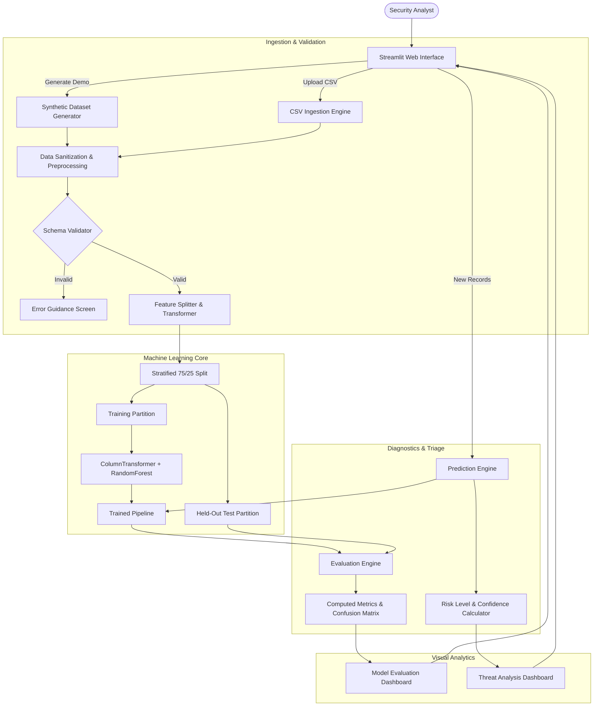
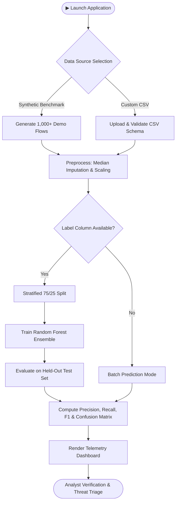

# AI-POWERED CYBER ATTACKS AND DEFENCE
### *Challenges, Detection, and Future Solutions*

[](https://www.python.org/)
[](https://opensource.org/licenses/MIT)
[](https://streamlit.io/)
[](https://scikit-learn.org/)
[]()

---

## Project Overview

**Cyber Guardian AI** is an interactive, academic-grade cybersecurity research prototype that analyzes network-traffic telemetry, classifies connection records into benign traffic and multiple threat categories, computes empirical evaluation metrics, and surfaces actionable security insights through an intuitive Security Operations Center (SOC) dashboard.

Developed by **Cyber Nexus**, this project illustrates how machine learning assists cybersecurity analysts in identifying anomalies and managing alert queues, while demonstrating why human verification and layered defense remain essential.

> ⚠️ **Educational Prototype Notice**: The default demonstration dataset is programmatically generated synthetic network-traffic data designed to demonstrate pipeline mechanics. High accuracy on synthetic data does not represent production enterprise intrusion prevention efficacy.

---

## Team & Academic Attribution

- **Student Name**: Harshal Harde
- **PRN**: 2125UCSM1001
- **Project Group**: Cyber Nexus
- **Guide**: Madhu B. Sir, Sanjivani University
- **Institutional Context**: Seminar Project, Sanjivani University
- **Project Title**: AI-Powered Cyber Attacks and Defence: Challenges, Detection, and Future Solutions
- **Proposed Framework**: Cyber Guardian AI
- **Domain**: Cybersecurity
- **Subdomain**: Artificial Intelligence in Cybersecurity
- **Repository**: [harshalharde45/Seminaraiphishing](https://github.com/harshalharde45/Seminaraiphishing.git)

---

## Problem Statement

Traditional network security controls primarily rely on signature-based Intrusion Detection Systems (IDS) and rigid rule engines. These approaches exhibit significant operational limitations:

1. **High False-Positive Volumes**: Benign statistical spikes trigger excessive low-priority alarms, causing severe analyst alert fatigue.
2. **Vulnerability to Dynamic Evasion**: Attackers leverage automated fuzzing, session fragmenting, and polymorphic payloads to bypass static hashes.
3. **Asymmetric Reaction Time**: Human analysts require hours to correlate disparate log lines, whereas automated exploits execute in seconds.
4. **Over-Promised Automation**: Deploying uncalibrated probabilistic models without human oversight creates costly disruption to legitimate business traffic.

---

## Project Motivation

Modern cyber defense requires intelligent systems capable of inspecting high-throughput telemetry at wire speed. By applying machine learning classification to statistical flow records, security teams can rapidly surface anomalous flows, prioritize high-risk connections, and identify subtle multi-vector attacks.

At the same time, this project demystifies AI in cybersecurity: it demonstrates how machine learning models actually evaluate features, where classification errors originate, and why human expertise must remain the ultimate authority in defensive operations.

---

## Research & Project Objectives

- **Modular Pipeline**: Construct an end-to-end pipeline covering ingestion, validation, preprocessing, ensemble learning, and post-prediction triage.
- **Multi-Vector Discrimination**: Classify connection flows across multiple categories: `BENIGN`, `DoS`, `DDoS`, `PortScan`, and `BruteForce`.
- **Honest Evaluation**: Compute and display authentic performance metrics directly from held-out test splits (no hardcoded scores or fabricated benchmark claims).
- **Interpretability**: Extract and visualize global feature importances to reveal the decision logic of the classifier.
- **Analyst-Centric UX**: Deliver a modern, dark-themed Streamlit interface featuring risk gauges, interactive confusion matrices, and clear navigation.

---

## Proposed Solution: Cyber Guardian AI

The **Cyber Guardian AI** architecture operates on a 7-stage data and intelligence pipeline:

$$\text{Data Ingestion} \longrightarrow \text{Validation \& Cleaning} \longrightarrow \text{Feature Transformation} \longrightarrow \text{ML Classification} \longrightarrow \text{Risk Assessment} \longrightarrow \text{Analyst Review} \longrightarrow \text{Feedback Loop}$$

1. **Data Ingestion & Validation**: Rejects malformed records and validates 20 standard flow features.
2. **Preprocessing**: Scales numeric columns via `StandardScaler`, one-hot encodes protocol categories, and handles missing/infinite values safely.
3. **Model Training**: Employs a 150-tree Random Forest classifier with `class_weight='balanced'` and stratified 75/25 train-test splitting.
4. **Empirical Evaluation**: Validates predictions on unseen held-out records, deriving accuracy, precision, recall, F1, and full confusion matrices.
5. **Operational Risk Mapping**: Translates raw probabilities into calibrated analyst confidence scores and two-tier risk flags (`LOW` vs. `HIGH`).

---

## Key Features

- 🛡️ **Interactive Multi-View Dashboard**: 8 dedicated workspaces tailored for threat analysts.
- 🔬 **Built-in Synthetic Data Generator**: Instant generation of reproducible 1,000+ record flow benchmarks.
- 📂 **Custom CSV Ingestion**: Support for uploading custom datasets with automated schema compliance checks.
- 🤖 **Random Forest Classifier**: Scikit-learn ensemble optimized for multi-class flow discrimination.
- 🎯 **Authentic Metric Computation**: Dynamic calculation of Accuracy, Macro Precision, Macro Recall, and Macro/Weighted F1.
- 🔍 **Interactive Confusion Matrix**: Heatmap visualization showing exact counts and true-class percentages.
- 📊 **False Positive / Negative Breakdown**: Dedicated per-class tabular accounting of Type I and Type II errors.
- 💡 **Automated Security Insights**: Rule-guided textual observations generated dynamically from model output distributions.
- 📚 **Threat Intelligence Library**: Educational coverage of emerging AI-assisted threats (phishing, deepfakes, malware, prompt injection).

---

## System Architecture



---

## Operational Workflow



---

## Technology Stack

| Layer | Technology | Version | Purpose |
|---|---|---|---|
| **Runtime** | Python | 3.12.10 | Core execution environment |
| **User Interface** | Streamlit | 1.40.0 | High-performance reactive web dashboard |
| **Machine Learning** | Scikit-Learn | 1.5.2 | Preprocessing pipelines, ensemble classifiers, metrics |
| **Data Manipulation** | Pandas | 2.2.3 | Tabular dataset management and aggregation |
| **Numerical Computing** | NumPy | 2.5.4 | Vectorized operations and random distributions |
| **Visualizations** | Plotly | 5.24.1 | Interactive telemetry and confusion matrix charts |
| **Static Plotting** | Matplotlib | 3.9.2 | Complementary statistical plotting |
| **Automated Testing** | Pytest | 8.3.3 | Regression and unit validation suite |

---

## Repository Structure

```
Seminaraiphishing/
├── app.py                      # Main Streamlit dashboard application
├── requirements.txt            # Pinned, reproducible project dependencies
├── README.md                   # Comprehensive repository documentation
├── LICENSE                     # MIT Open Source License
├── .gitignore                  # Git exclusion rules (caches, models, data)
├── .streamlit/
│   └── config.toml             # Streamlit dark cybersecurity theme configuration
├── src/
│   ├── __init__.py             # Package marker
│   ├── data_processing.py      # Validation, sanitization, synthetic generation
│   ├── model.py                # Scikit-learn Pipeline and Random Forest classifier
│   ├── detection.py            # Workflow orchestration and risk categorization
│   ├── evaluation.py           # Metric calculation and false-positive/negative analysis
│   └── visualizations.py       # Interactive Plotly and Matplotlib charting routines
├── data/
│   └── README.md               # Dataset documentation and expected CSV schema
├── tests/
│   ├── conftest.py             # Pytest fixtures and synthetic testing data
│   ├── test_data_processing.py # Ingestion, validation, and cleaning tests
│   ├── test_model.py           # ML pipeline, reproducibility, and prediction tests
│   ├── test_detection.py       # Workflow orchestration and risk scoring tests
│   └── test_evaluation.py      # Metric computation and boundary condition tests
├── docs/
│   ├── introduction.md         # Research context and AI dual-use landscape
│   ├── problem-statement.md    # Analysis of modern network threat detection challenges
│   ├── objectives.md           # Engineering and research goals
│   ├── proposed-solution.md    # Detailed framework architecture
│   ├── methodology.md          # 7-phase research process
│   ├── architecture.md         # Technical component specifications
│   ├── threat-model.md         # STRIDE threat assessment and risk matrix
│   ├── testing.md              # Test execution summary and coverage details
│   ├── limitations.md          # Engineering constraints and academic disclosures
│   ├── future-scope.md         # Technical roadmap and planned enhancements
│   ├── references.md           # Peer-reviewed academic citations
│   ├── demonstration-guide.md  # Script for live demonstration
│   └── viva-questions.md       # 23 Viva questions with technical answers
├── diagrams/
│   ├── architecture.mmd        # Mermaid source for architecture diagram
│   └── workflow.mmd            # Mermaid source for operational workflow
└── screenshots/
    └── README.md               # Guidance for capturing and storing interface screenshots
```

---

## Installation & Setup

### Prerequisites
- Python 3.11 or 3.12 installed on your system.
- Git configured locally.

### Step-by-Step Installation

1. **Clone the Repository**:
   ```bash
   git clone https://github.com/harshalharde45/Seminaraiphishing.git
   cd Seminaraiphishing
   ```

2. **Create and Activate a Virtual Environment** (Recommended):
   ```bash
   # Windows PowerShell
   python -m venv venv
   .\venv\Scripts\Activate.ps1
   ```

3. **Install Dependencies**:
   ```bash
   pip install -r requirements.txt
   ```

---

## Running the Application

Launch the Streamlit web dashboard:
```bash
streamlit run app.py
```

The application will start locally and open in your default browser at `http://localhost:8501`.

---

## How to Use the Application

### 1. Using Demonstration Data (Recommended for Quick Evaluation)
1. In the sidebar, select **🏠 Overview** or **🧪 AI Detection Lab**.
2. Click **"🔬 Load Demo Dataset"** or **"🔬 Generate Synthetic Dataset"**.
3. Navigate to **🧪 AI Detection Lab** and click **"🚀 Train Classifier"**.
4. The pipeline performs an automated stratified split, fits 150 decision trees, and computes real metrics on the held-out test split.
5. Review the resulting classification report, confusion matrix, and feature importances under **⚠️ Threat Analysis** and **📊 Model Evaluation**.

### 2. Uploading a Custom CSV Dataset
1. Prepare a CSV file containing the expected 20 flow features (refer to [data/README.md](data/README.md) for the exact schema).
2. Go to **🔍 Data Explorer** or **🧪 AI Detection Lab**.
3. Upload the file using the file uploader widget.
4. If a `label` column is present, the app will enable training and full evaluation.
5. If the file is unlabelled, the model will run in **Prediction-Only Mode**, assigning predicted threat labels and risk categories to each row.

---

## Explanation of Evaluation Metrics

All metrics in Cyber Guardian AI are calculated empirically against held-out test records:

- **Accuracy**: $\frac{TP + TN}{TP + TN + FP + FN}$ — The total percentage of records correctly classified.
- **Precision (Macro)**: $\frac{1}{K}\sum \frac{TP_k}{TP_k + FP_k}$ — Measures the reliability of positive attack predictions across all $K$ classes. High precision indicates minimal false alarms.
- **Recall (Macro)**: $\frac{1}{K}\sum \frac{TP_k}{TP_k + FN_k}$ — Measures the fraction of actual attacks successfully flagged. High recall indicates minimal missed intrusions.
- **F1-Score (Macro)**: Harmonic mean of Macro Precision and Macro Recall. Provides a balanced single metric that treats minority and majority classes equally.
- **Confusion Matrix**: Visual grid contrasting ground truth labels against model predictions.
- **False Positive (FP)**: Legitimate traffic erroneously flagged as an attack (causes analyst fatigue).
- **False Negative (FN)**: Malicious intrusion misclassified as benign (causes security breaches).

---

## Test Execution & Verification

The project includes a comprehensive automated test suite implemented in `pytest`:

```bash
python -m pytest tests/ -v --tb=short
```

**Actual Verified Outcome**:
```
======================= 71 passed, 1 warning in 40.97s ========================
```

The 71 tests rigorously validate:
- Synthetic generation schema compliance and non-null guarantees.
- Ingestion bounds, malformed CSV error handling, and whitespace cleaning.
- Dataframe preprocessing, missing value imputation, and infinity replacements.
- Scikit-learn pipeline integrity, stratified split consistency, and prediction shape.
- Confusion matrix computations, multi-class metrics, and per-class FP/FN calculations.

---

## Limitations & Responsible Use

1. **Synthetic Data**: The built-in benchmark dataset is synthetically generated. Model metrics obtained on synthetic data do not represent real-world network detection efficacy.
2. **Concept Drift**: Attack patterns evolve rapidly. Real-world deployments require regular retraining on fresh traffic telemetry.
3. **No Autonomous Enforcement**: Cyber Guardian AI is an analyst decision-support system. It must not be configured to autonomously drop or block network traffic without human verification.
4. **Encrypted Payloads**: As a flow-based classifier, the model analyzes metadata (timing, byte volume, frequency) rather than encrypted packet payloads.

---

## Future Enhancements

- 🧠 **Explainable AI (XAI)**: Integration of SHAP and LIME for per-connection local feature attributions.
- 📡 **Live Packet Ingestion**: Real-time packet capture via `pyshark` and live flow aggregation.
- ⏳ **Sequential Deep Learning**: Bidirectional LSTM / Transformer models for temporal session tracking.
- 🔄 **Zero Trust & SOAR Connectors**: Authenticated webhooks for automated SIEM alert escalation.

---

## References

1. Breiman, L. (2001). *Random Forests.* Machine Learning, 45(1), 5-32.
2. Tavallaee, M., Bagheri, E., Lu, W., & Ghorbani, A. A. (2009). *A Detailed Analysis of the KDD CUP 99 Data Set.* IEEE CISDA.
3. Sharafaldin, I., Lashkari, A. H., & Ghorbani, A. A. (2018). *Toward Generating a New Intrusion Detection Dataset (CIC-IDS2017).* ICISSP.
4. Sommer, R., & Paxson, V. (2010). *Outside the Closed World: On Using Machine Learning for Network Intrusion Detection.* IEEE S&P.
5. Pedregosa, F., et al. (2011). *Scikit-learn: Machine Learning in Python.* JMLR.

---

## License

This project is licensed under the MIT License — see the [LICENSE](LICENSE) file for details.
